<p align="center">
  
</p>

<h1 align="center">MoneyTrack</h1>

<p align="center">
  <b>Apuntas un gasto en tres segundos y el mes se explica solo.</b><br />
  Finanzas personales en español (y en inglés), sin conectar el banco.
</p>

<p align="center">
  <a href="https://moneytrack.iagoestevez.com"><b>Probar la app →</b></a>
  &nbsp;·&nbsp;
  <a href="#cómo-se-usa">Cómo se usa</a>
  &nbsp;·&nbsp;
  <a href="#puesta-en-marcha-en-local">Instalar en local</a>
</p>

<p align="center">
  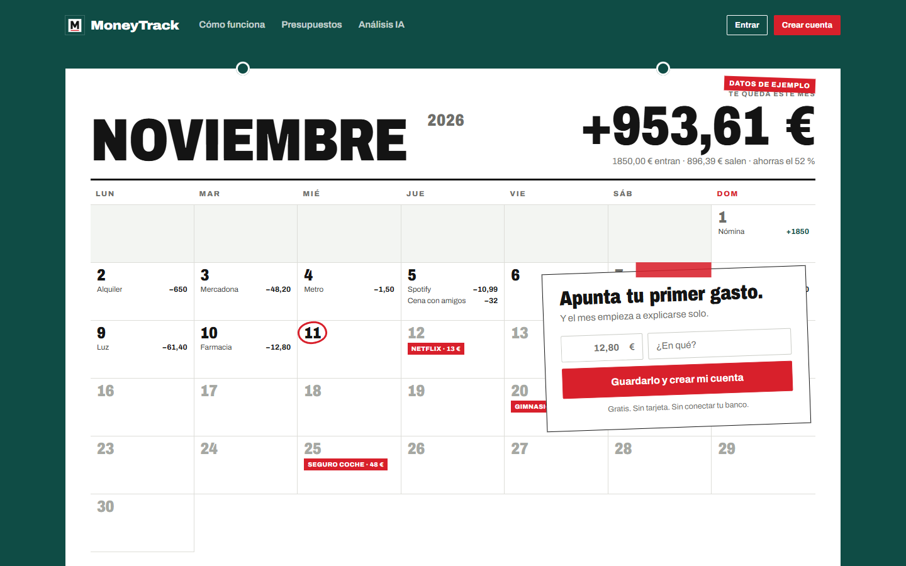
</p>

> Todas las capturas usan **datos de ejemplo**. Ninguna muestra cuentas reales.

---

## La idea

La mayoría de apps de finanzas te piden mucho antes de darte algo: conectar el banco, categorizar cientos de movimientos, configurar cuentas. MoneyTrack va al revés.

- **Tres segundos por apunte.** Importe, concepto y listo. La categoría se propone sola (la última que usaste) y la fecha es hoy.
- **Una hoja por mes.** La pantalla principal es lo que pegarías en la nevera: lo que te queda, qué días han costado y qué falta por pagar.
- **Avisos antes, no después.** Un límite te avisa al 80 % (o al porcentaje que elijas) con los días que quedan, cuando todavía puedes cambiar algo.
- **Tus datos, solo tuyos.** No hay conexión con el banco ni anuncios. Cada usuario solo puede leer lo suyo (Row Level Security en todas las tablas).

El mundo visual se llama **«el calendario de la cocina»**: una pared verde, una hoja blanca, dos tintas (negra y rojo rotulador) y el verde solo para lo que entra. Está documentado en [DESIGN.md](DESIGN.md).

---

## Cómo se usa

### 1. Pruébala antes de crear la cuenta

La portada es la propia app con datos de ejemplo. Escribes tu primer gasto en la nota pegada a la hoja y, al registrarte, ya está apuntado. Nada de formularios vacíos.

<p align="center">
  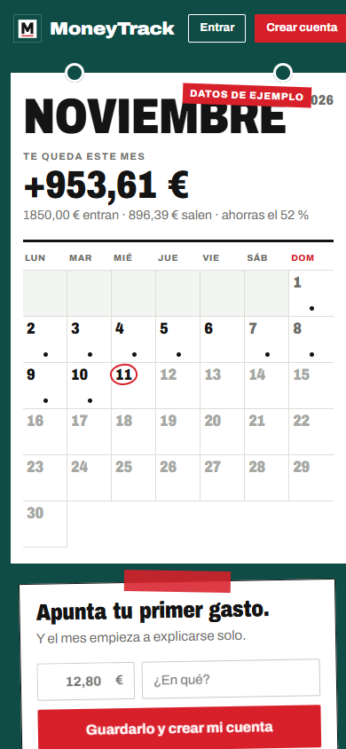
</p>

### 2. El Resumen: tu mes en una hoja

Una cifra grande (lo que te queda), una tira de 30 días con el gasto de cada día y, debajo, lo que todavía queda por pagar y tus últimos apuntes. Pasa por un día para ver su detalle; púlsalo para filtrar.

<p align="center">
  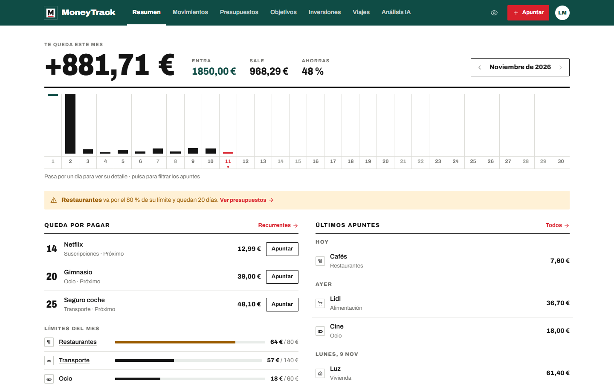
</p>

### 3. Apuntar desde cualquier sitio

El botón **Apuntar** está siempre a mano: arriba a la derecha en el ordenador y en el centro de la barra inferior en el móvil. Se abre encima de lo que estés viendo, apuntas y sigues.

<p align="center">
  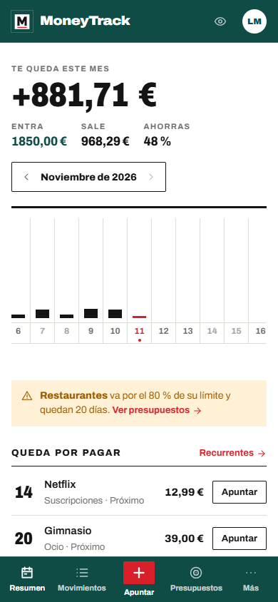
  &nbsp;&nbsp;
  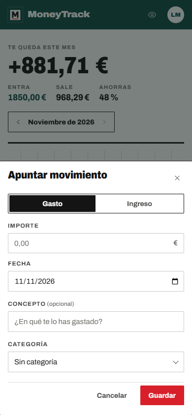
</p>

### 4. Límites que avisan a tiempo

Un tope mensual por categoría. Cada límite muestra cuánto queda, para cuántos días y, si vas rápido, en cuánto acabarías al ritmo actual. En la misma pantalla están los **recurrentes** (alquiler, Netflix, el gimnasio): se apuntan con un clic y nunca se duplican.

<p align="center">
  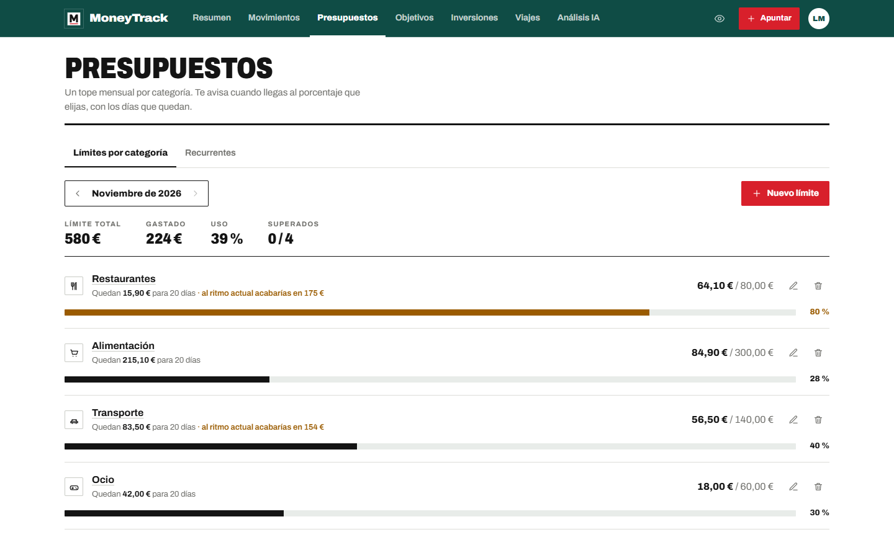
</p>

### 5. Movimientos, objetivos, inversiones y viajes

| | |
|---|---|
| 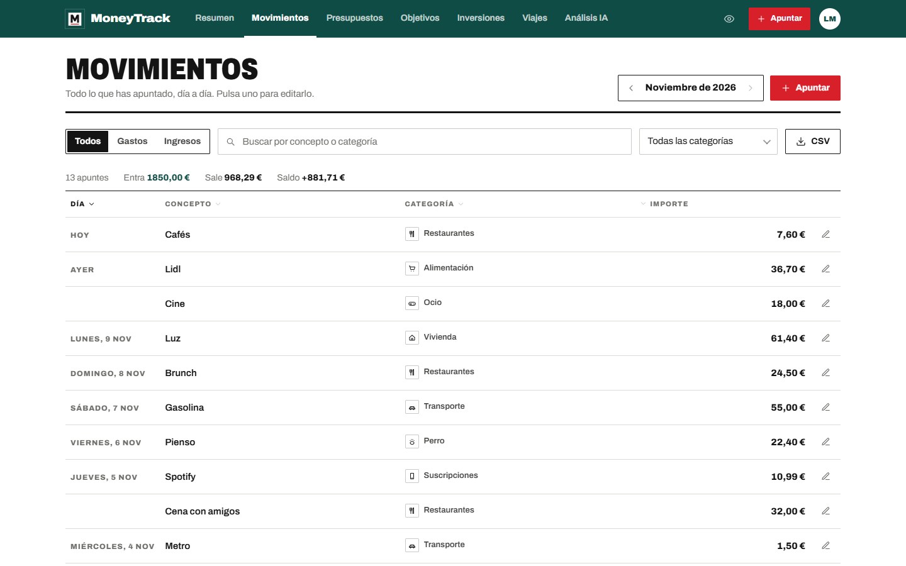 | 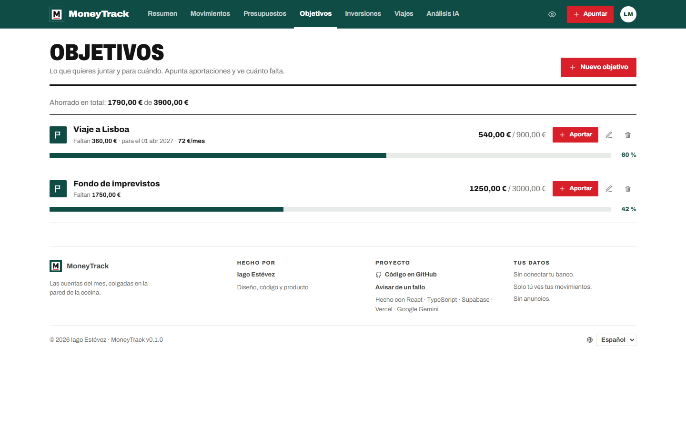 |
| **Movimientos**: todo lo apuntado por día, con búsqueda, filtros y orden que viven en la URL (se pueden enlazar y compartir), y exportación a CSV. | **Objetivos**: lo que quieres juntar y para cuándo. Te dice cuánto ahorrar cada mes para llegar. |

- **Inversiones**: apuntas cada aportación y, de vez en cuando, el valor que ves en tu broker. Ves lo aportado frente a lo que vale de verdad, sin que cuente como gasto del mes.
- **Viajes**: agrupa gastos ya apuntados, con total, media por día y comparativa entre escapadas.

### 6. Análisis con IA sobre tu propio historial

Gemini lee tus apuntes (no promedios de nadie) y devuelve avisos con tipo e impacto, una predicción del mes que viene categoría a categoría con su nivel de confianza, y la evolución de los últimos seis meses. Pulsar una categoría lleva a sus movimientos. El análisis responde en el idioma de la app.

<p align="center">
  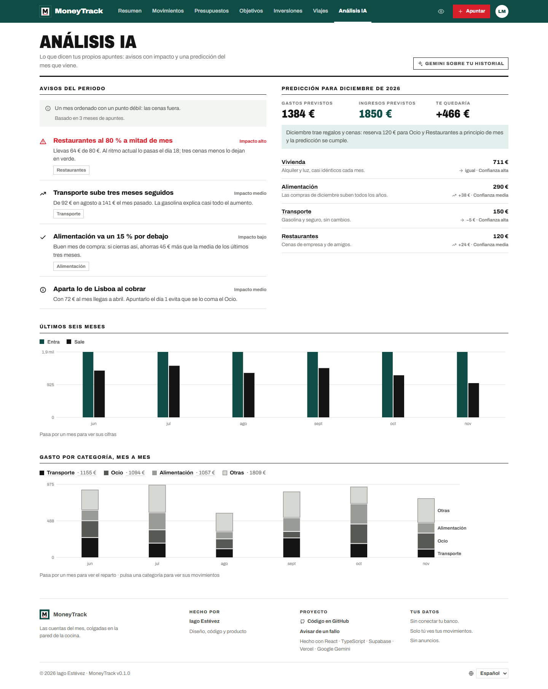
</p>

---

## Tú decides cómo se ve

**Ajustes** está separado por secciones: Cuenta, Idioma y región, Apariencia, Apuntes y avisos, Categorías, Tus datos y Acerca de.

<p align="center">
  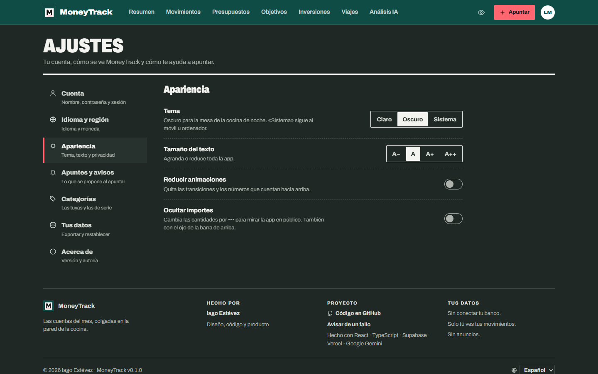
</p>

| Ajuste | Qué hace |
|---|---|
| **Idioma** | Español o inglés: textos, fechas, números y también las respuestas de la IA. |
| **Moneda** | El símbolo de los importes (euro, dólar, libra, pesos, real). |
| **Tema** | Claro, oscuro o el del sistema. El oscuro es gris verdoso, no negro: se lee bien de noche sin deslumbrar. |
| **Tamaño del texto** | Cuatro tamaños; escala toda la app. |
| **Reducir animaciones** | Quita transiciones y números que cuentan, aunque el sistema no lo pida. |
| **Ocultar importes** | Cambia todas las cifras por `•••` para abrir la app en público. También con el ojo de la barra superior. |
| **Al apuntar, empezar por** | Gasto o ingreso por defecto. |
| **Proponer la última categoría** | Si apuntaste en Alimentación, el siguiente empieza ahí. |
| **Aviso de los límites nuevos** | El porcentaje de aviso con el que nace cada límite. |
| **Pantalla al entrar** | Resumen, Movimientos, Presupuestos o Análisis. |

<p align="center">
  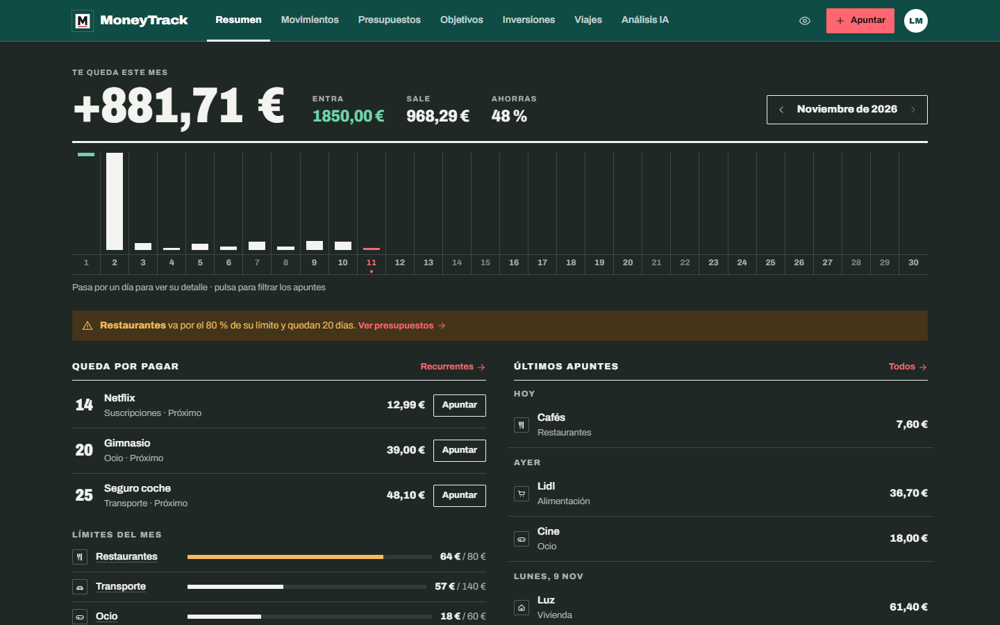
</p>

<p align="center">
  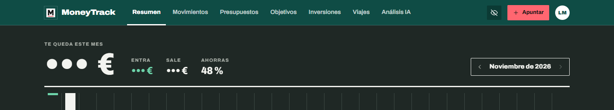
</p>

---

## Decisiones de experiencia

Pequeñas reglas que se repiten en toda la app:

- **Estados vacíos que enseñan.** Cada pantalla vacía dice qué aparecerá ahí y ofrece el primer paso, nunca un «No hay datos».
- **Primer mes guiado.** Tres pasos con acciones reales (primer gasto, primer límite, primer recurrente) que desaparecen al completarse.
- **Borrar siempre pide confirmación** en la propia hoja y explica qué se conserva («los movimientos no se tocan»). Nunca un `window.confirm`.
- **Errores que dicen qué hacer.** «No hay conexión. Comprueba tu red e inténtalo de nuevo», no un código.
- **Todo se puede enlazar.** Filtros, mes y sección de ajustes viven en la URL.
- **Accesible por teclado y lector de pantalla:** enlace para saltar al contenido, regiones `aria-live` para avisos, interruptores con `role="switch"`, contraste AA en claro y oscuro.
- **Instalable (PWA).** Se añade a la pantalla de inicio del móvil y abre directamente en la app.

---

## Arquitectura

| Capa | Tecnología |
|---|---|
| Frontend (`frontend/`) | React 18, TypeScript estricto, Vite, CSS Modules sobre tokens, React Query, Zod |
| Backend (`api/`) | Vercel Serverless Functions en TypeScript (Express en local) |
| Datos y acceso | Supabase (PostgreSQL + Auth) con RLS en todas las tablas |
| IA | Google Gemini con `responseSchema`, caché de 6 h por usuario e idioma y cupo diario |
| Idiomas | `t('texto en español')` con diccionario inglés en `frontend/src/i18n/en.ts`; un test falla si falta una traducción |

Movimientos y categorías pasan por `/api` (validación Zod en servidor). Viajes, objetivos, recurrentes e inversiones van directos a Supabase desde el cliente, protegidos por RLS y validados con Zod. Más detalle del diseño en [DESIGN.md](DESIGN.md) y del producto en [PRODUCT.md](PRODUCT.md).

---

## Puesta en marcha en local

### 1. Instalar dependencias

```bash
npm install
cd frontend && npm install
```

### 2. Variables de entorno

Raíz (`/.env`):

```env
SUPABASE_URL=...
SUPABASE_ANON_KEY=...
GEMINI_API_KEY=...
GEMINI_MODEL=gemini-3.5-flash-lite   # opcional
AI_MAX_CALLS_PER_USER_PER_DAY=10     # opcional: llamadas reales a Gemini por usuario y endpoint cada 24 h
AI_MAX_CALLS_PER_DAY=300             # opcional: techo global de llamadas a Gemini cada 24 h
CRON_SECRET=...                      # obligatorio en Vercel para el cron keep-alive
```

`CRON_SECRET` es una cadena aleatoria larga. Vercel la envía al llamar al cron `/api/cron/keepalive` (una vez al día) y el endpoint rechaza cualquier llamada sin ella.

`frontend/.env.local`:

```env
VITE_SUPABASE_URL=...
VITE_SUPABASE_ANON_KEY=...
```

### 3. Migraciones

Ejecuta en orden, en el SQL Editor de Supabase, los archivos de `supabase/migrations/`:

| Archivo | Qué crea |
|---|---|
| `001_initial_schema.sql` | perfiles, categorías (con semilla), movimientos |
| `002_rls_policies.sql` | políticas RLS base |
| `003_budgets.sql` | presupuestos mensuales |
| `004_events.sql` | viajes y vínculo con movimientos |
| `004_shopping_list.sql` | lista de la compra (módulo retirado de la interfaz; la tabla puede eliminarse) |
| `005_rate_limiting.sql` | límite de peticiones a la IA |
| `20260529_ai_cache.sql` | caché de la IA |
| `006_savings_goals.sql` | objetivos de ahorro |
| `007_recurring_transactions.sql` | recurrentes |
| `008_budget_alert_threshold.sql` | umbral de aviso configurable en cada presupuesto |
| `009_apply_recurring_rpc.sql` | función para apuntar un recurrente de forma atómica |
| `010_investments.sql` | inversiones: aportaciones y valores anotados |

**Recuperar contraseña:** en Supabase, *Authentication → URL Configuration*, añade a *Redirect URLs* `https://moneytrack.iagoestevez.com/restablecer` y `http://localhost:5173/restablecer`.

### 4. Arrancar

```bash
npm run dev                  # API en http://localhost:3001
cd frontend && npm run dev   # app en http://localhost:5173 (proxy /api → 3001)
```

Comprobaciones: `npm test` (Vitest) y `npm run typecheck` en la raíz y en `frontend/`.

---

## Autoría

Diseñada y desarrollada por **[Iago Estévez](https://github.com/iagoesteevezz)**: producto, diseño y código.
¿Algo no va bien? [Abre una incidencia](https://github.com/iagoesteevezz/moneytrack/issues).

---

## Licencia

© 2026 Iago Estévez Pérez. Todos los derechos reservados.

MoneyTrack es software propietario: no se permite usarlo, copiarlo, modificarlo ni distribuirlo sin permiso escrito. Las condiciones completas están en [LICENSE](LICENSE), y las licencias de los componentes de terceros, en [THIRD_PARTY_LICENSES](THIRD_PARTY_LICENSES).

Solicitudes de licencia: [iagoesteevezz@gmail.com](mailto:iagoesteevezz@gmail.com)
